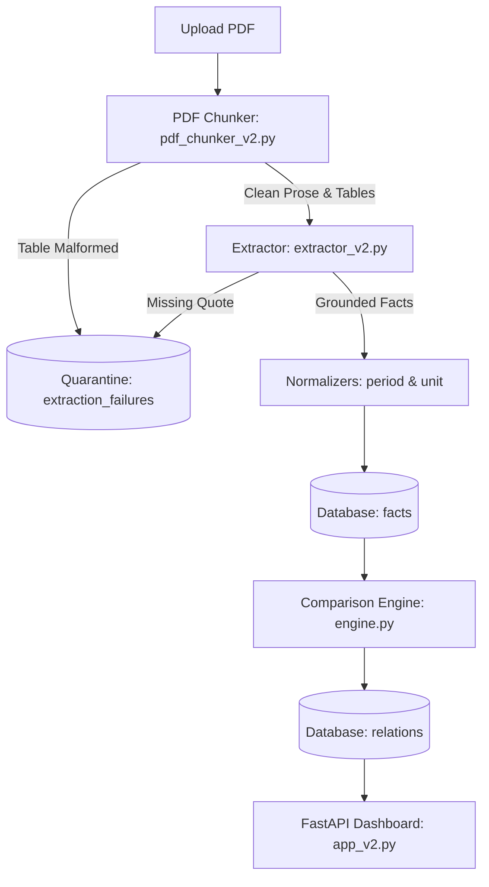

# Contributing to Fulcrum

Thank you for your interest in contributing to Fulcrum! Fulcrum is a Fact Knowledge Layer designed to extract, normalize, and reconcile numerical and qualitative claims across complex multi-document financial and macroeconomic reports (such as the RBI Annual Report, IMF Article IV Consultations, and Union Economic Surveys).

---

## 1. Architectural Overview

The Fulcrum pipeline operates through modular, independent stages:



- **`src/parser/pdf_chunker_v2.py`**: Reads PDF documents with `pdfplumber`, splits pages into prose and table chunks, and quarantines broken multi-page tables.
- **`src/extractor/extractor_v2.py`**: Extracts structured facts via LLM with strict verbatim source quote validation.
- **`src/normalizer/`**: Deterministic pure functions for standardizing timeframes (`period_normalizer.py`) and dimensions/currencies (`unit_normalizer.py`).
- **`src/comparison/entity_resolver.py`**: Fast two-stage entity resolution using exact aliases (`config/entity_aliases.json`) and semantic embeddings (`SentenceTransformer('all-MiniLM-L6-v2')`).
- **`src/comparison/engine.py`**: Classifies fact pairs into corroborations, contradictions, and reconciliations using externalized heuristics (`config/comparison_rules.json`).
- **`src/db/database.py`**: Thread-safe SQLite persistence layer with atomic batch writes and foreign key enforcement.
- **`src/app_v2.py`**: FastAPI web application serving the dashboard and REST API endpoints.

---

## 2. Core Invariants & Contribution Rules

When contributing code, you must strictly uphold the following project invariants:

1. **Verbatim Quotation Grounding Invariant**: Any extracted fact must contain an exact verbatim substring from the source document chunk. If an LLM hallucinates or alters wording in `source_quote`, the fact must be rejected or quarantined.
2. **Deterministic Normalization**: All unit transformations, dimensional safety checks, and fiscal period mappings must remain pure deterministic functions. Never use LLM approximations for arithmetic comparisons or unit conversions.
3. **No Hardcoded Domain Cues in Code**: Domain keywords, institutional aliases, variance markers, and sector qualifiers must live in editable JSON configuration files inside `config/` rather than hardcoded sets in Python modules.
4. **Zero Committed Secrets**: Never commit live API keys or authentication credentials to git. Set `OPENROUTER_API_KEY` via `.env` or system environment variables.
5. **Schema Compatibility**: Maintain consistency with the active SQLite schema (`chunk_id`, `extraction_run_id`, `source_doc`).

---

## 3. Development Setup

### Prerequisites
- Python 3.9+ (Python 3.11 recommended)
- Git

### Installation
```bash
# Clone repository
git clone https://github.com/Harshitmishra001/Fulcrum.git
cd Fulcrum

# Create and activate virtual environment
python -m venv .venv
source .venv/bin/activate       # On Linux/macOS
# .venv\Scripts\Activate.ps1    # On Windows PowerShell

# Install dependencies
pip install -r requirements.txt
```

### Running the Application
```bash
uvicorn src.app_v2:app --reload
```
Open `http://localhost:8000` in your browser.

---

## 4. Running Tests

All 50 tests in Fulcrum run locally and offline without requiring an OpenRouter API key:

```bash
# Run the entire test suite
pytest -v

# Run targeted test suites
pytest tests/test_api_health_stats.py -v
pytest tests/test_api_export.py -v
pytest tests/test_auditor3_remediation.py -v
pytest tests/test_upload_security.py -v
```

Before submitting a Pull Request, ensure that `pytest -v` exits with code 0 (100% passing).

---

## 5. Commit & Pull Request Guidelines

We follow the [Conventional Commits](https://www.conventionalcommits.org/) specification:

- `feat:` A new feature or endpoint
- `fix:` A bug fix or schema patch
- `docs:` Documentation improvements
- `test:` Adding or updating tests
- `refactor:` Code refactoring without behavioral changes
- `ci:` Continuous integration changes

### Pull Request Checklist
- [ ] Automated tests pass (`pytest -v`).
- [ ] Code follows existing formatting and style.
- [ ] No plaintext secrets or API keys are committed.
- [ ] New endpoints or features are covered with unit tests.
- [ ] Documentation (`README.md` and `AUDIT.md`) is kept up-to-date.
